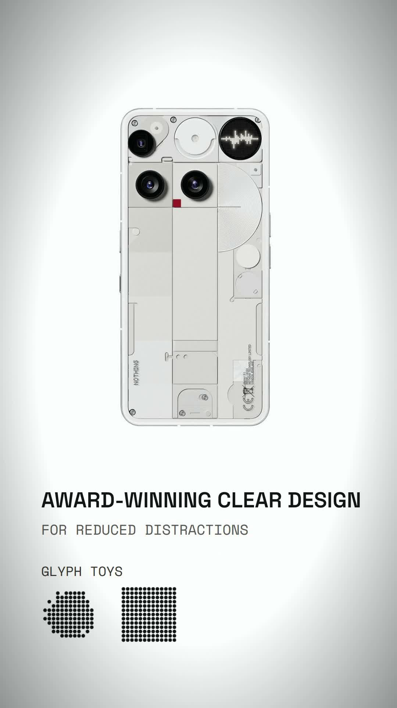

# MOSEN Ad Studio

**Claude Skill — Code-Rendered Brand Ads & Product Promos (9:16-first)**

[](LICENSE) [](https://github.com/masonmosen/mosen-ad-studio/stargazers)

**Mason OPC's ad-film studio** — brand ads and product promos made entirely
as code: one HTML page, a paused GSAP timeline rendered frame by frame, and
a Python-synthesised score. 9:16-first, platform-native, with a concept
gate, product anchoring, a rhythm & motif system, and an 8-dimension
director's review.

## Demo

> **Demo example — Nothing Phone (3), 20s.** Code-rendered from the `nothing` brand kit (official product photos). This demo is a style example, **not a product-anchoring benchmark**: official product photos appear in about 10 of 20 seconds, below the skill's own ≥60% product-anchoring rule — the kit itself flags this film as a cautionary case.
>
> **Demo 示例——Nothing Phone (3)，20 秒。** 用 `nothing` 品牌 kit 代码渲染（官方产品图）。这只是风格示例，**不是产品锚定达标范例**：官方产品照片出镜约 10/20 秒，低于技能自身 ≥60% 的产品锚定要求，该 kit 本身就把它标为警示案例。



[Watch the 20-second demo (MP4, 1080×1920)](docs/demo/nothing-glyph-20s-final.mp4) · [Closing frame, 19.6s](docs/demo/still-lockup-19p6s.jpg)

## Install

```sh
python3 scripts/new_film.py ~/projects/my-film --brand dji-pocket4
# fill brief.md → get the concept confirmed (G1) → assets/copy/shot-list
# build film/index.html, then render with scripts/render_draft.sh / scripts/render_final.sh
```

Or install via the Skills CLI (`npx skills add masonmosen/mosen-ad-studio`) — it will ask which agent to install into.

## What you get

- **Concept gate** — one-line concept and product gate before any code.
- **Product anchoring** — the real product is the visual lead (≥ 60% of runtime).
- **Impact rules** — R4 cut contrast, R5 transition quota, M6 audible accent on every boundary.
- **Motif scoring** — one motif, three appearances; a Python-synthesised score.
- **8-dimension director's review** — including 力道 (punch) with a veto; transition-midpoint frames are mandatory review material.
- **9 real brand productions** behind the spec: iPhone, MUJI, Heineken, Olipop ×3, Nothing, Rhode, DJI Pocket 4, La Mer, MERIDIAN.

Forked from [nutllwhy/code-brand-film](https://github.com/nutllwhy/code-brand-film)
(MIT) and rebuilt to spec v1.1 after nine real productions (iPhone, MUJI,
Heineken, Olipop ×3, Nothing, Rhode, DJI Pocket 4, La Mer, MERIDIAN).

## What's different from upstream

- **Concept gate (brief.md)** — one-line concept, product gate （选品关）,
  signature transition from the product's own shape, before any code.
- **Product anchoring** — the real product is the visual lead (≥ 60% of
  runtime); a code-drawn device may never star.
- **Impact rules** — R4 cut contrast, R5 transition quota, M6 audible accent
  on every boundary; review dimension 8 is 力道 (punch), with a veto.
- **Motif scoring** — one motif, three appearances; a vacuum drop before
  the biggest reveal; VO-first cutting on measured phrase boundaries.
- **Platform layer** — IG poster-frame aesthetics × TikTok retention
  (H1–H10 hook library, re-hooks, 60% twist, loop design, safe zones).
- **Review discipline** — transition-midpoint frames are mandatory review
  material; settled frames alone are how flat films ship.
- **Production lessons** — `references/production-lessons.md`: every scar
  from nine productions (immediateRender traps, stage-colour sampling,
  amix truncation, loudnorm vs transient peaks, render-landing delays).

## Layout

```
SKILL.md            the studio manual (start here)
references/         upstream craft docs + brief / rhythm / scoring-v2 /
                    platform-native / hooks / production-lessons
templates/          brief + shot-list templates (v1.1 fields)
kits/               brand kits (stage, palette, type, motif, signature)
                    + series/ (Mosen Lab)
scripts/            film_audit.py · layout_audit.mjs (aspect-aware) ·
                    frame_audit.py · rhythm_audit.py (new) ·
                    new_film.py (scaffold) · render_draft/final.sh ·
                    deliver_pack.sh · score_lib.py / score_template.py
examples/           upstream office-agent example
```

## Quick start

```sh
python3 scripts/new_film.py ~/projects/my-film --brand dji-pocket4
# fill brief.md → get the concept confirmed (G1) → assets/copy/shot-list
# build film/index.html, then:
python3 scripts/film_audit.py film/index.html
AUDIT_W=1080 AUDIT_H=1920 node scripts/layout_audit.mjs film/index.html --shots .gates/shots
scripts/render_draft.sh          # review (8 dimensions, midpoints!)
scripts/render_final.sh          # then score, mix, verify -14 LUFS on the final file
scripts/deliver_pack.sh ~/projects/my-film film/renders/<final>.mp4 1.2 7.2 18.6
```

## License

MIT (upstream license retained in `LICENSE`; see `THIRD_PARTY_NOTICES.md`).

---

## More from MOSEN

- [muse-video-prompt-skill](https://github.com/masonmosen/muse-video-prompt-skill) — Prompt engineering workflow for Muse built-in video generation.
- [ip-picture-workshop](https://github.com/masonmosen/ip-picture-workshop) — Photo + text → multi-page illustrated IP carousel.
- [mason-opc-motion-video](https://github.com/masonmosen/mason-opc-motion-video) — Talking-head video + script → editable motion-graphics video.
- [remake-depth-breakdown](https://github.com/masonmosen/remake-depth-breakdown) — Reference video → depth video + Seedance-ready prompts.
- [cueshot-starter-skills](https://github.com/masonmosen/cueshot-starter-skills) — Free starter skills for AI video shot planning & review.
- [reference-video-blueprint](https://github.com/masonmosen/reference-video-blueprint) — Authorized reference video → original Prompt Contract.
